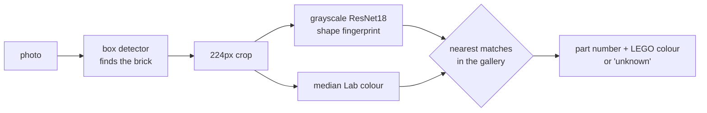
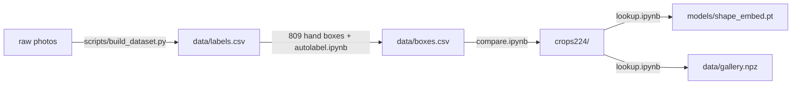

# LEGO Fusion Battle Towers: brick recognition

Recognise every LEGO piece in a photo of a tower built from LEGO set **21205 (Fusion Battle Towers)**: which shape and which colour, so the tower can eventually be rebuilt as a 3D model.

| Task | Status | Result |
|---|---|---|
| Name a brick photographed **alone on a table** | ✅ works | 98–99% shape + colour |
| Add a **new piece** without retraining | ✅ works | ~20 photos; shapes never trained on: 81% |
| Name every brick in a **real tower photo** | ❌ open problem | bricks are found, naming is unreliable ([why](docs/explanation/why-towers-fail.md)) |

## Try it (5 lines)

```python
import lego_lookup as L, numpy as np
emb, gal = L.load_embedder(), L.load_gallery()
[(path, crop)] = L.crops_from_photos(['dataset/3005_5_4113915/IMG_1074.JPG'])
shape, sim, color, _ = L.recognize(gal, L.embed(emb, [crop]), np.array([L.brick_lab(crop)]), closed_set=True)[0]
print(shape, color, round(sim, 3))   # -> 3005 5 0.997   (brick 1x1, LEGO colour 5 = Tan)
```

New here? Follow the **[tutorial](docs/tutorial.md)** (10 minutes: install, download, recognise your first brick).

## How it works



Instead of a classifier with fixed classes, every brick is compared with a **gallery** of ~20 reference photos per piece. Teaching a new piece = adding photos, no retraining. Full explanation: [how recognition works](docs/explanation/how-recognition-works.md).

How the data was made:



## Documentation

| I want to… | Read |
|---|---|
| get started | [Tutorial](docs/tutorial.md) |
| download the photos and weights | [Get the data](docs/how-to/get-data.md) |
| add a new piece or colour | [Add a piece](docs/how-to/add-piece.md) |
| retrain the models / rebuild the gallery | [Retrain](docs/how-to/retrain.md) |
| label photos | [Label photos](docs/how-to/label.md) |
| know what a file, column or folder is | [Data files](docs/reference/data-files.md) · [Folders](docs/reference/folders.md) · [`lego_lookup` API](docs/reference/lego_lookup.md) |
| understand the design | [How recognition works](docs/explanation/how-recognition-works.md) · [Why towers fail](docs/explanation/why-towers-fail.md) · [Decisions](docs/explanation/decisions/) |
| know what the data and model are good for | [Datasheet](docs/datasheet.md) · [Model card](docs/model-card.md) |
| see every experiment | [Notebooks](#notebooks) · [Development log](docs/DEVELOPMENT_LOG.md) |

## Notebooks

The experiments. Each one opens with *what it does / needs / writes*, explains every cell, and ends with a conclusion.

| # | Notebook | Question |
|---|---|---|
| 1 | `eda` | What does the dataset look like? |
| 2 | `autolabel` | How were 6491 photos boxed from 809 hand boxes? |
| 3 | `blur` | Which photos are blurry, what needs reshooting? |
| 4 | `compare` | CNN vs YOLO vs Faster R-CNN on single bricks |
| 5 | `lookup` | The gallery lookup: accuracy, unknown pieces, new pieces |
| 6 | `renders` | Can 3D renders replace real photos? |
| 7 | `test_real` | What happens on real towers |
| 8 | `synth` | YOLO trained on fake pasted towers |
| 9 | `towers` | Random 3D towers with exact labels, `.ldr` export |
| 10 | `tower_seg` | Brick segmenter trained on 3D towers |
| 11 | `pipeline` | Classic image processing: tower mask → one region per brick |

## Repo map

```
lego_lookup.py     the recogniser (every notebook and script uses it)
ldraw_render.py    GPU renderer for LDraw parts and towers
app.py             web app to add new pieces
scripts/           dataset building, labelling, adding pieces
notebooks/         experiments (see above)
data/              labels, boxes, gallery (in git)
models/            shape_embed.pt in git, other weights downloaded
docs/              this documentation
```
